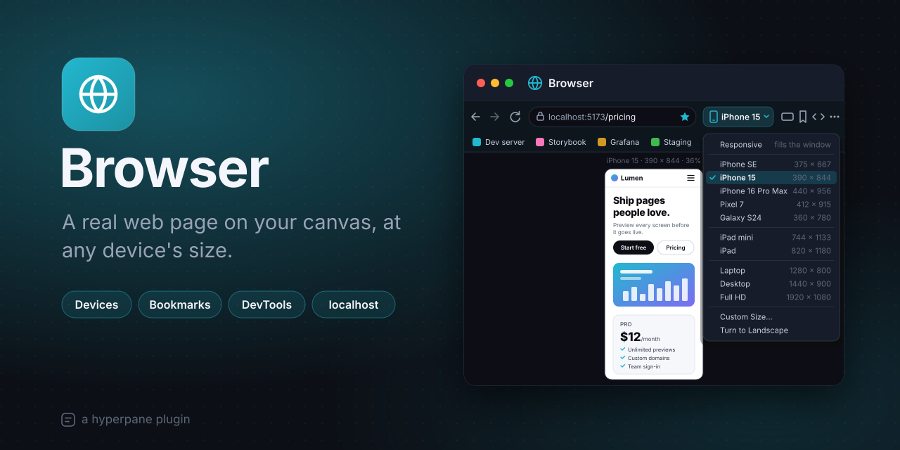

# Browser

A real web page on your canvas, at any device's size. Put your dev server,
a dashboard or the docs you're reading right next to the code and
terminals they belong to. Each Browser window is one page, so you can lay
several side by side: the phone view beside the desktop one, staging
beside local.

## Features

- **A real page:** Chromium, the app's own, sandboxed from the app. Its
  cookies and sign-ins are kept for the Browser alone.
- **An address bar that knows dev work:** type a URL, `localhost:5173`,
  just a port (`5173`), a file's path, or words to search with the search
  engine you choose.
- **Devices:** show the page at a phone's, a tablet's or a computer's size
  (iPhone, Pixel, Galaxy, iPad, laptop, desktop, Full HD), with that
  browser's user agent so sites send their mobile pages, scaled to fit the
  window. Or pick a size of your own, and turn it to landscape and back.
- **Links open beside it:** ⌘-click a link (Ctrl+click on Windows and
  Linux), or follow a link that opens a new window, and it opens in a new
  Browser window on the canvas.
- **Bookmarks:** star a page, then find it in the bookmarks bar, the
  Bookmarks menu, or on a blank window. Rename, move or remove one from
  its right-click menu. They're shared by every Browser window.
- **Developer tools:** Chromium's DevTools for the page, and Inspect
  Element in its right-click menu.
- **Shared with the project:** the page, the device and its turn are kept
  in the project, so everyone on it sees the same.

## How to use

1. Open it: the globe in the canvas's toolbar, beside the drawing tools.
   (Right-click the globe to hide it; Plugins → Browser shows it again.)
   An `.html` file can open in it too.
2. Type an address and press Enter.
3. Pick a device from the menu beside the address bar, and turn it with
   the button next to it.

| Key | What it does |
| --- | --- |
| ⌘L (Ctrl+L) | Go to the address bar |
| ⌘R (Ctrl+R), ⇧⌘R (Ctrl+Shift+R) | Reload; reload ignoring the cache |
| ⌘[ and ⌘] (Ctrl+[ and Ctrl+]) | Back and forward |
| ⌘D (Ctrl+D) | Bookmark the page, or remove its bookmark |
| ⌥⌘I (Ctrl+Alt+I) or F12 | Developer tools |

## Settings

| Setting | What it does | Default |
| --- | --- | --- |
| Home page | What a new Browser opens (anything the address bar takes). Empty: your bookmarks. | empty |
| Device | The size a new Browser shows pages at. Responsive fills the window. | Responsive |
| Bookmarks bar | Shows your bookmarks under the address bar, when you have some. | on |
| Search engine | Where words typed in the address bar go: DuckDuckGo, Google, Bing, Brave Search, Startpage, Ecosia, or your own. | DuckDuckGo |
| Custom search URL | With a custom search engine: its address, with `%s` where the words go. | empty |

## Permissions

| Permission | Why |
| --- | --- |
| `webview` | To show a web page in its window. |

## Good to know

- It works in the desktop app only: a web page needs the app's Chromium.
- One page per window, no tabs: open another window for another page.
- Bookmarks are kept on this computer; the page each window shows is kept
  in the project.

## How it works

The page itself is the app's (`sdk/RPC.md` §8): a plugin with the
`webview` permission asks for one with `host.web.load(url)` and says where
it goes in its frame with `host.web.place(rect)`. The Browser's window
draws the bar, the bookmarks and a device's outline, and places the page
inside it, scaled to fit.

| Where | What it is |
| --- | --- |
| `src/client/app/` | The window (`Browser.tsx`) and its parts: the page (`usePage.ts`), where it goes (`useStage.ts`), the device (`useDevice.ts`), bookmarks (`useMarks.ts`), keys and menus. |
| `src/client/views/` | The bar, the bookmarks, a device's outline and a page's error. |
| `src/client/lib/` | What the address bar takes, the devices, bookmarks and history. |

## Develop

    ./build.sh --test

## License

MIT, © 2026 Astralyx. See [LICENSE](LICENSE).
